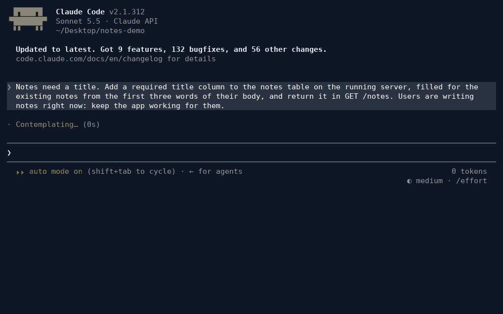
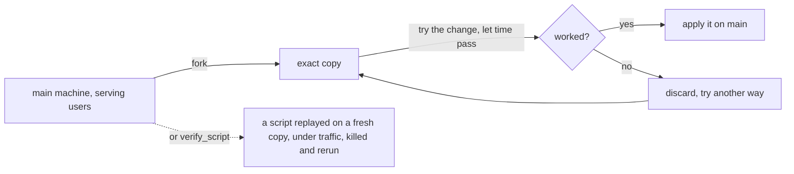

<p align="center"></p>

<h1 align="center">chronobox</h1>

<p align="center"><b>A Linux machine with exact undo and forks, for coding agents, as an MCP server.</b><br>
Fork the live server, try the fix on the copy, and apply it for real once it works.</p>

<p align="center">
  <a href="https://github.com/Geawher/chronobox/actions/workflows/ci.yml"></a>
  <a href="LICENSE"></a>
  
  
</p>

<p align="center"></p>

<p align="center"><sub>A real Claude Code session (Sonnet 5.5, 39 s) on <a href="examples/notes">examples/notes</a> while users keep writing notes, shortened to fit.
<a href="docs/demo">Recorded with docs/demo/record.sh</a>.</sub></p>

## Why

**Let an agent test its reasoning on a copy of reality before it acts.** When an agent
works on a live system, each step of its plan is a guess: "this migration is safe under
traffic", "this setting stops the out-of-memory kills". Usually the only way to check a
guess is to run it in production. With chronobox the agent forks the running machine,
runs the step on the exact copy, watches what happens, and changes the real machine only
once the copy shows it works. If something still goes wrong, it can roll the whole
machine back. In our benchmark this made models safer, and let a cheaper model match a
stronger one ([below](#does-it-help)).

Agents that work on real systems (upgrade a dependency, migrate a database, change
a live config) make mistakes that cannot be undone with `git`: data is gone, a
service restarted and lost its in-memory state, clients were told their writes
succeeded. chronobox gives the agent a machine where those mistakes are cheap:

- **checkpoint / rollback** the whole machine — disk, memory, running processes,
  open database transactions — restored in ~50 ms;
- **fork** the live machine into exact copies, try a risky change there while the
  real machine keeps serving, let time pass, compare, then apply the verified change
  (or promote the copy, or throw it away);
- **reports and lessons**: discarding a fork tells the agent what it changed and that
  the main machine is still untouched; lessons come back on later forks and rollbacks;
- an optional **rehearsal guard**: destructive commands on the main machine are refused
  until they succeeded on a fork (or are forced).



There is no search or autopilot inside: the agent decides when to use the tools.

## Install

You need **x86_64 Linux with KVM**, **Docker** and [uv](https://docs.astral.sh/uv/). No root.
macOS and Windows are not supported; a Linux VM with nested virtualization works.

```bash
uv tool install git+https://github.com/Geawher/chronobox
chronobox setup     # Firecracker, a guest kernel, the tools drive and the default image (5-10 min, once)
chronobox doctor    # checks KVM, Docker and the files, then boots a machine
```

Then add it to your agent. In Claude Code, from the folder you work in:

```bash
claude mcp add chronobox -- chronobox mcp
```

Each session then gets its own machine (boot ≈ 1 s). Other MCP clients (Codex, Cursor...), disk
use, uninstalling and working from a checkout: [docs/install.md](docs/install.md).

## Try it

[examples/notes](examples/notes) is a small notes web app with its PostgreSQL database. After
installing:

```bash
git clone https://github.com/Geawher/chronobox && cd chronobox/examples/notes
claude mcp add chronobox -- chronobox mcp --project .
claude
```

Then ask for a change on the running server, for example:

> Notes need a title. Add a required title column to the notes table on the running server,
> filled for the existing notes from the first three words of their body, and return it in
> GET /notes. Keep the app working for its users.

The first session prepares the machine (about a minute) and saves a warm start; the next ones
start in under a second.

## Does it help?

We measured it on [chronobox-ops](https://github.com/Geawher/chronobox-ops), our benchmark of
operations tasks on live production machines, each with a hazard a careful engineer avoids. Every
run is Claude Code with its normal tools; "alone" is the same Claude Code without chronobox. On 34
tasks:

| Model | Success: alone → chronobox | Harm: alone → chronobox | Cost per run |
|---|---|---|---|
| Haiku 4.5 | 29% → 37% | 55% → 43% | $0.15 → $0.19 |
| Sonnet 5 | 75% → **85%** | 24% → **12%** | $0.46 → $0.56 |
| Sonnet 5.5 | 72% → **86%** | 26% → **12%** | $0.11 → $0.13 |
| Opus 4.8 | 82% → **89%** | 13% → **7%** | $1.09 → $1.26 |
| Opus 5.5 | 96% → 96% | 3% → 4% | $0.30 → $0.34 |

- **A cheaper model matches a stronger one:** Sonnet 5.5 with chronobox does as well as Opus 4.8
  alone, at $0.13 per run instead of $1.09.
- **The same model is safer:** Sonnet 5.5 succeeds on 14 points more runs and harms users half as
  often, both outside chance.
- **Handing over a script was safer still** for every model (preliminary, 10 tasks).
- **It does not help** the strongest model (Opus 5.5 already succeeds alone), and costs about
  15-25% more per run for the rehearsals.

Both measurements, intervals and where it does not help: [docs/results.md](docs/results.md).

## Use it on your own system

The agent can work on an exact, running copy of your project: your image, your services, your
data. A `chronobox.toml` next to your code says how to bring it up
([example](examples/notes/chronobox.toml)):

```bash
cd path/to/app
chronobox init                     # a starter chronobox.toml, an AGENTS.md guide, .chronobox/ in .gitignore
chronobox build --project .        # the image it declares, once
claude mcp add chronobox -- chronobox mcp --project .
```

The first session saves a warm start, and later ones restore it in about 0.1 s. The agent gets
its changes back to you as a patch (`diff`), or, for changes that are actions (a migration, a
restart), as a script that chronobox replays first on a fresh copy, under traffic, killed midway
and run again.

- [Your own image and project](docs/projects.md): `chronobox.toml`, warm starts, `chronobox up`,
  every `chronobox mcp` option.
- [Hand-offs](docs/handoff.md): `verify_script`, and what you tell it about production.
- [The agent's tools](docs/tools.md): checkpoints, forks, rollbacks, per profile.

## Documentation

| Page | What is in it |
|---|---|
| [Installing](docs/install.md) | other MCP clients, disk use, uninstalling, from a checkout |
| [Your own image and project](docs/projects.md) | `chronobox.toml`, warm starts, options |
| [Hand-offs](docs/handoff.md) | scripts replayed before you run them |
| [The agent's tools](docs/tools.md) | every tool, per profile |
| [Does chronobox help?](docs/results.md) | the benchmark results in full |
| [How it works](docs/how-it-works.md) | microVMs, snapshots, long-lived machines, limits, code layout |
| [Security](docs/security.md) | what is isolated and what is not |

## Security

Each machine is a Firecracker microVM with no network: what runs in it cannot reach your host or
the internet. Commands inside run as root, and a `chronobox.toml` is code, like a Makefile: use
chronobox on repositories you trust. Details: [docs/security.md](docs/security.md). Report a
vulnerability privately: [SECURITY.md](SECURITY.md).

## Contributing

Issues and pull requests are welcome: see [CONTRIBUTING.md](CONTRIBUTING.md) for the setup and the
checks, and [CHANGELOG.md](CHANGELOG.md) for what changed between versions.

## License

Apache-2.0, see [LICENSE](LICENSE).
